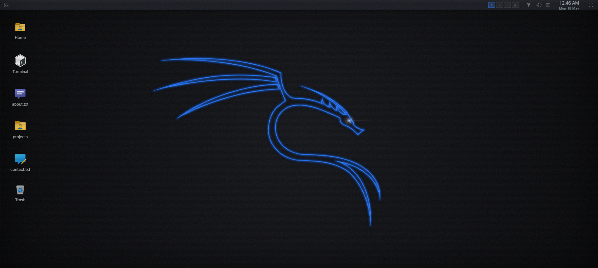

# Kali XFCE Portfolio


<p align="center">
  
</p>

<p align="center">
  <a href="https://me.zis3c.dev/">Live demo</a>
  ·
  <a href="https://github.com/zis3c/Kali-XFCE-Portfolio/issues">Issues</a>
  ·
  <a href="CONTRIBUTING.md">Contributing</a>
</p>

An interactive portfolio that simulates a **Kali Linux XFCE desktop** in the
browser. It ships two experiences: a full Kali desktop simulation with a boot
flow, login screen, draggable windows, terminal, file manager, editor, and app
launcher, plus a minimal Portfolio Mode for quick reading.

> [!WARNING]
> This is a simulation for portfolio and educational use. It is not a real
> operating system, and it does not provide real system access.

## Highlights

- Dual experience: Kali XFCE desktop or minimal Portfolio Mode
- Boot chooser with keyboard navigation and a simulated BIOS screen
- Login flow with configurable demo password
- Draggable, resizable windows with focus, minimize, and close states
- Terminal emulator with a virtual filesystem and custom commands
- Thunar-style file manager with folder, rename, and delete actions
- Mousepad-style text editor with find, replace, and save
- Chrome-style in-app browser shell with history navigation
- Command palette, keyboard shortcuts, and reduced-motion support
- Portfolio sections for about, projects, experience, skills, and contact
- Contact API with validation, rate limiting, and SendGrid delivery
- Health endpoint with MongoDB status
- Security headers, request correlation IDs, and structured logging

## Tech stack

| Layer      | Choice                                               |
| ---------- | ---------------------------------------------------- |
| Framework  | Next.js 16 (Pages Router, ISR)                       |
| Language   | TypeScript 5.4 (strict)                              |
| UI         | React 18, styled-components 5                        |
| State      | Redux 4, Redux Thunk, next-redux-wrapper             |
| API        | Next.js API routes with next-connect                 |
| Database   | MongoDB with Mongoose                                |
| Email      | SendGrid                                             |
| Testing    | Jest, Enzyme, React Test Utils                       |
| Tooling    | ESLint, Prettier, Husky, lint-staged, Commitizen     |
| Security   | npm audit gate, CodeQL, Dependabot, security headers |
| Deployment | Vercel                                               |

## Requirements

- Node.js **20.9 or newer**
- npm 10 or newer
- MongoDB connection string for the contact and health endpoints
- SendGrid API key for email delivery

## Getting started

```bash
git clone https://github.com/zis3c/Kali-XFCE-Portfolio.git
cd Kali-XFCE-Portfolio
npm ci --legacy-peer-deps
cp .env.example .env.local
npm run dev
```

Open `http://localhost:3000`.

### Environment variables

| Variable                    | Required | Purpose                                       |
| --------------------------- | -------- | --------------------------------------------- |
| `DB_URI`                    | Yes      | MongoDB connection string                     |
| `SENDGRID_API_KEY`          | Yes      | SendGrid API key                              |
| `GOOGLE_EMAIL_ADDRESS`      | Yes      | Recipient and sender address for contact mail |
| `NEXT_PUBLIC_DEMO_PASSWORD` | No       | Login password, defaults to `1234`            |
| `NEWS_API_KEY`              | No       | Enables the news widget                       |
| `NEWS_URL_QUERY`            | No       | News API URL without the key                  |

`DB_URI`, `SENDGRID_API_KEY`, and `GOOGLE_EMAIL_ADDRESS` are required at runtime.
The app still boots without the optional variables, but the related widgets and
features stay disabled.

## Scripts

| Command                 | Description                                               |
| ----------------------- | --------------------------------------------------------- |
| `npm run dev`           | Start the development server on port 3000                 |
| `npm run build`         | Create a production build with Next.js                    |
| `npm run start`         | Start the production server                               |
| `npm run lint`          | Run ESLint with zero warnings allowed                     |
| `npm run typecheck`     | Run `tsc --noEmit`                                        |
| `npm run format`        | Format the repository with Prettier                       |
| `npm run format:check`  | Check formatting                                          |
| `npm run test`          | Run the Jest suite                                        |
| `npm run test:coverage` | Run tests with coverage thresholds                        |
| `npm run audit`         | Check production dependencies for high or critical issues |
| `npm run cm`            | Commit with Commitizen                                    |

## Usage

### Boot chooser

The first screen is a simulated BIOS boot menu. Use the arrow keys to select a
target and press Enter, or click one of the boot options:

- **Portfolio Mode**: the minimal reading experience
- **Kali Linux XFCE Mode**: the full desktop simulation

### Kali desktop

1. Watch the boot sequence, then press Enter or click to skip it.
2. Log in with `NEXT_PUBLIC_DEMO_PASSWORD` (default `1234`).
3. Use the desktop icons, panel, application menu, or terminal.

Useful shortcuts:

| Shortcut         | Action                                  |
| ---------------- | --------------------------------------- |
| `Ctrl+Alt+T`     | Open a terminal                         |
| `Ctrl+K`         | Open the Portfolio Mode command palette |
| `J` / `K`        | Scroll the Portfolio Mode page          |
| `Left` / `Right` | Move focus between projects             |
| `Enter`          | Open the focused project                |
| `Escape`         | Close the palette or the exit dialog    |

### Portfolio Mode

Portfolio Mode keeps the same content with a simpler layout and a terminal or
paper theme. The power button opens a confirmation dialog before returning to the
boot menu.

## Architecture

The application is split into a Pages Router shell, a Redux state layer, and a
simulated desktop UI.

```text
pages/
  index.tsx              boot chooser, login, desktop, portfolio modes
  api/contact            validated, rate-limited contact endpoint
  api/health             MongoDB status and uptime

components/
  Desktop, SystemTray    desktop shell and panel
  Apps/                  Terminal, FileManager, TextViewer, browser
  PortfolioMode/         minimal portfolio experience
  Widgets, Windows       desktop widgets and window manager

store/                   Redux reducers and thunks
backend/                 Mongoose models, controllers, DB helpers
middleware/              rate limit, errors, request IDs, security headers
utils/                   virtual filesystem, logger, retry, env validation
hooks/                   reusable React hooks
types/                   shared TypeScript types
design-system/           theme tokens and global styles
```

| Folder           | Responsibility                                 |
| ---------------- | ---------------------------------------------- |
| `pages/`         | Routing, server-side data fetching, API routes |
| `components/`    | Desktop, apps, widgets, Portfolio Mode         |
| `store/`         | Redux reducers and action creators             |
| `backend/`       | Database models and email controller           |
| `middleware/`    | API security and error handling                |
| `utils/`         | Pure helpers, filesystem simulation, logging   |
| `hooks/`         | React hooks for UI behaviour                   |
| `design-system/` | Theme tokens and global CSS                    |
| `test/`          | Test helpers and mock store                    |

## Project structure

```text
Kali-XFCE-Portfolio/
├── backend/                 # Controllers, models, DB helpers
├── components/              # Desktop, apps, widgets, portfolio UI
│   ├── Apps/                # Terminal, FileManager, TextViewer, browser
│   ├── PortfolioMode/       # Portfolio sections and modals
│   └── icons/               # Inline SVG icon set
├── design-system/           # Theme tokens and global styles
├── docs/                    # Testing and quality documentation
├── e2e/                     # Playwright smoke spec (manual run)
├── hooks/                   # Custom React hooks
├── middleware/              # API middleware
├── pages/                   # Next.js pages and API routes
├── public/                  # Images, icons, wallpapers, manifest
├── store/                   # Redux reducers and action creators
├── test/                    # Test utilities and page tests
├── types/                   # TypeScript types
├── utils/                   # Virtual filesystem, logger, retry
├── .github/                 # CI, CodeQL, Dependabot, issue templates
├── jest.config.js
├── next.config.js
├── package.json
├── tsconfig.json
└── README.md
```

## Testing and quality

The project uses strict CI gates:

```bash
npm run lint
npm run typecheck
npm run format:check
npm run test:coverage
npm run audit
npm run build
```

The Jest suite covers API routes, middleware, Redux, utilities, hooks, and UI
components. Coverage thresholds are enforced at 92% statements, 94% lines, 91%
functions, and 82% branches. See `docs/TESTING.md` for the full test inventory.

The `e2e/` folder contains a Playwright smoke spec. Playwright is not installed
by default and the spec is not part of CI yet, so run it manually after installing
Playwright.

## Security

- Security headers are configured in `next.config.js` and the API middleware.
- Contact requests are validated, rate-limited, and checked for allowed origins.
- `npm run audit` fails on unapproved high or critical production findings.
- CodeQL and Dependabot run in GitHub Actions.
- Do not report vulnerabilities in a public issue. Follow `SECURITY.md`.

## Deployment

The live site runs on Vercel at <https://me.zis3c.dev/>. Configure the environment
variables from the table above in the Vercel project before deploying. The build
command is `npm run build`.

## Contributing

Read `CONTRIBUTING.md` before opening a pull request. Keep changes focused, add
tests for new behaviour, and run the quality gates listed above.

## License

MIT. See [LICENSE](LICENSE).
